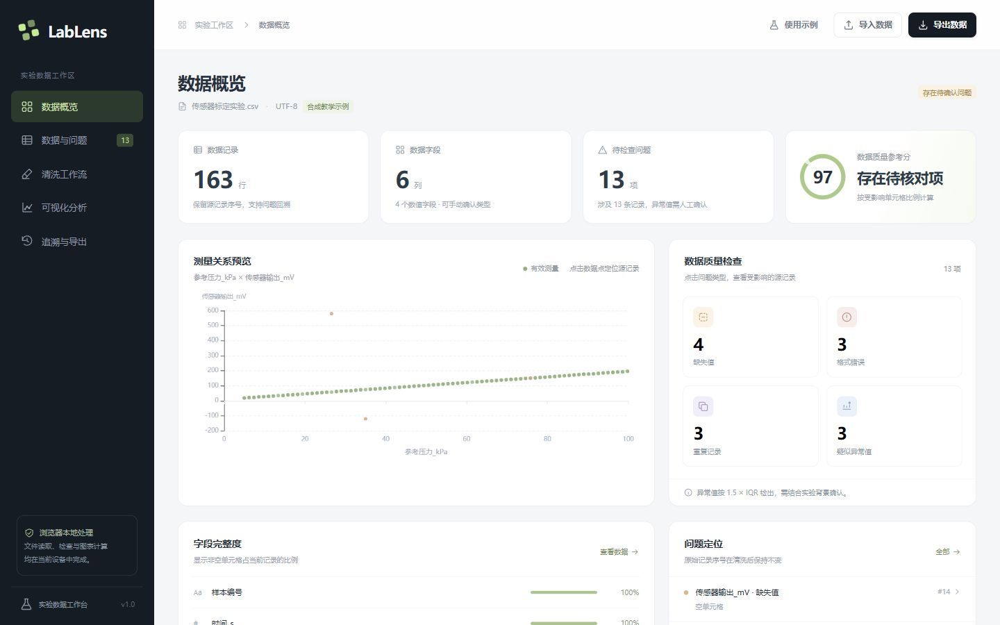

# LabLens · 实验数据体检与可视化工作台

面向本科实验课的表格数据整理：从 CSV / TSV / XLSX 导入，定位数据问题，预览并确认清洗，再生成图表与可追溯报告。数据读取和计算在当前浏览器完成，运行时无需 API Key。



## 十分钟复现

环境：Node.js **22.18 或更新版本**，现代桌面浏览器。实际验证环境为 Windows、Node.js 22.19.0；其它平台需要自行核对安装环境。

### 方式一：运行包含 dist 的交付包

解压后双击 `Start-LabLens.cmd`，或在该目录执行：

```powershell
node --env-file-if-exists=.env server.mjs
```

打开 <http://127.0.0.1:4173/>。该方式不需要安装 npm 依赖；保持服务窗口开启，按 Ctrl+C 停止。不要直接双击 `dist/index.html`，文件导入与 SHA-256 需要正常本地 HTTP 环境。

### 方式二：从 GitHub 源码构建

```powershell
git clone https://github.com/LoscX-X/Work-1.git lab-data-workbench
cd lab-data-workbench
npm ci
npm run build
npm start
```

打开 <http://127.0.0.1:4173/>。首次安装依赖需要网络；构建后的应用使用随包保留的本地图表与解析库。

### 复现检查点

1. 首页示例应显示 **163 行、6 列、13 个检查项**。
2. “数据与问题”可以按缺失、格式错误、重复和疑似异常筛选；点击图表点可以定位源记录。
3. “追溯与导出” → “导入配置并回放”，选择 `public/samples/sensor-cleaning-recipe.json`。
4. 核对七步操作和结果指纹，确认回放后应为 **150 行、0 个当前检查项**。
5. “可视化分析”选择 X=`参考压力_kPa`、Y=`传感器输出_mV`、分组=`实验组`。应有 150 对观测，斜率约 **1.87459**，R² 约 **0.99982**。
6. 导出 CSV、处理 JSON、配置和 HTML 报告，重新打开核对结果。

示例是固定种子生成的**合成教学数据**。当前检查通过和高 R² 只描述该示例及所选规则，不能据此证明真实实验的真实性或清洗决定合理。

## 已实现的工作流

| 环节 | 行为 |
| --- | --- |
| 文件导入 | CSV / TSV，UTF-8 与 GB18030 回退；XLSX 工作表选择。保留字符串、原始测量精度和来源指纹。 |
| 数据体检 | 缺失值、声明类型下的格式错误、额外重复行、1.5×IQR 疑似异常。保留问题依据与源记录位置。 |
| 清洗预览 | 首尾空白、数值写法规范、无效值置空、填充、移除缺失/重复/确认异常记录、列类型确认、单格修正。 |
| 历史 | 预览不改变当前数据；确认后进入历史，支持撤销、重做及回到已保留步骤。 |
| 分析 | 散点、趋势、分布；切换字段和分组，原始值/当前结果对照，OLS 线性拟合、统计和排除计数。 |
| 来源 | 填充与人工修正单独标记，默认排除所选分析轴上的填充值；原始记录编号在移除操作后保持不变。 |
| 导出与回放 | 当前全表 CSV、自包含 HTML、完整变更 JSON、清洗配置 JSON、图表 PNG；源文件与结果指纹一致后原子回放。 |

清洗配置只重放数据处理。图表字段、分组、排除策略和统计口径保存在完整处理记录与报告中。

## 环境配置

没有必填配置或服务密钥。需要改端口时复制 `.env.example` 为 `.env`，修改 `PORT`，再运行 `npm start`。例如 `PORT=4174` 后访问 `http://127.0.0.1:4174/`。端口被占用时可停止已有服务或选用其它端口。

## 工程结构

```text
src/
  components/          原创展示组件、表格与参数/预览对话框
  views/               概览、数据、清洗、分析、追溯五个页面
  hooks/               导入、历史、图表设置、配置与导出状态
  lib/                 领域类型、解析、体检、统计和文件适配
  features/
    import/            Excel 单元格与编号格式适配
    cleaning/          纯操作、不可变历史、来源、配置协议
    charts/            观测收集、排除口径和图表配置
    reports/           完整处理记录、HTML 和图像生成
  styles/              基础、布局、页面和响应式样式
public/
  samples/             合成输入与实际导出的七步清洗配置
  vendor/              固定版本解析/图表库及来源哈希
tests/                 领域、清洗、回放与导出测试
docs/ai/               实际阶段任务、验证、Git 对应和公开对话摘录
docs/evidence/         真实浏览器操作与下载结果
tools/                 合成数据、导出核查和材料生成工具
```

React 19.3.1、TypeScript 7.0.2、Vite 8.3.8；Papa Parse 5.5.3、ExcelJS 4.4.0、Apache ECharts 6.0.0。展示组件为本项目编写，实际来源与许可证见 [THIRD_PARTY_NOTICES.md](THIRD_PARTY_NOTICES.md)。

## 开发与验证

```powershell
npm run dev
npm run check
npm run format:check
python tools/verify_export_evidence.py
```

`check` 包含类型检查、25 项测试和生产构建。Python 命令只用标准库交叉核对保存的实际浏览器导出文件，不是自动浏览器测试框架。

已完成正常界面的真实导入、问题定位、清洗预览/取消/确认、撤销重做、填充来源、图表切换、配置回放、错误源拒绝及文件下载检查。覆盖范围、证据和未覆盖环境见 [验证记录](docs/validation.md)。

## 使用边界

- 支持 XLSX，不支持旧版 XLS。公式只读已有缓存结果，不执行公式；无缓存结果请在 Excel 中重新计算并保存。
- 类型推断可人工确认；IQR 是提示规则，删除需结合实验背景确认。
- Excel 编号类字段支持简单全零格式；其它数值格式读取底层值，不声称复刻全部 Excel 显示格式。
- CSV 是文本格式。外部表格软件若自动将编号转换为数字，需按文本列导入；文件中的前导零仍保留。
- 当前工作区在内存中，刷新前请导出配置。刷新后导入同一原文件与配置恢复；没有云端账户或自动持久化。
- CSV 源编号是略过空白记录后的记录位置，包含表头；含跨行引号文本时不等于物理文本行号。Excel 使用工作表行号。
- 未宣称完成所有移动端、浏览器、编码及超大文件组合的验证。

## 比赛材料

- [技术 PDF](output/pdf/LabLens-Technical-Documentation.pdf)
- [录屏操作与逐段讲稿](docs/recording-guide.md)
- [真实 AI 协作摘录](docs/ai/actual-dialogue-excerpts.md)
- [三轮核心迭代任务与验证](docs/ai/)
- [提交清单](docs/SUBMISSION.md)

实际视频由参赛者录制。报名、账户缴费和比赛上传状态以参赛者的比赛账号为准。
